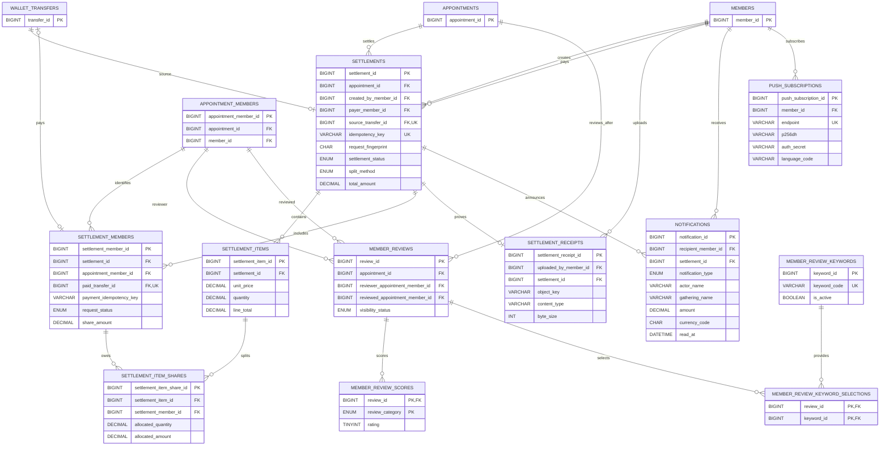

# 정산·리뷰 ERD

약속 완료 후의 비용 분담과 참가자 리뷰 구조를 보여준다.

- 정산은 약속의 참가자 집합과 원거래를 기준으로 생성합니다.
- DB는 행별 금액과 수량이 음수가 되지 않도록 검증합니다. 항목·참가자 간 합계
  일치는 후속 서비스 트랜잭션에서 검증합니다.
- 후기 키워드 기준값은 `FRIENDLY`, `ON_TIME`, `CONSIDERATE`,
  `GOOD_COMMUNICATOR`, `WOULD_JOIN_AGAIN`이며 화면 문구는 Vue i18n에서 관리합니다.
- `source_transfer_id` UNIQUE는 하나의 원거래가 여러 정산에 사용되는 것을 막는다.
- 생성 멱등성은 `(created_by_member_id, idempotency_key)` UNIQUE와 요청 지문으로
  보장한다.
- `paid_transfer_id` UNIQUE와 `PAID` 상태의 이체·시각 CHECK는 지급을 한 번만 확정한다.
- ITEMIZED 정산의 품목과 품목별 수량 배분은 정산 자체의 스냅샷으로 보관한다.
- 리뷰 작성자와 대상자는 같은 약속의 `appointment_members`로 제한한다.

## 영수증

`settlement_receipts`는 영수증 사진이 S3 어디에 있는지만 가리킨다. 사진 자체는 DB에 넣지
않는다.

`settlement_id`가 비어 있는 행은 아직 정산에 붙지 않은 **초안**이다. 사용자가 사진을 먼저
올리고 품목을 확정한 뒤 정산을 만들 때 이 값이 채워진다. 정산 품목이 영수증에서 나온
값이라 사진이 먼저 있어야 하기 때문이다.

`settlement_id`에 UNIQUE가 걸려 있다. MySQL은 UNIQUE 열에 NULL을 여러 개 허용하므로 초안
여러 개가 공존하면서도 정산 하나에는 사진이 한 장만 붙는다.

`object_key`는 반드시 `receipts/`로 시작한다. IAM 정책이 이 접두사로 좁혀져 있어 벗어난
키는 런타임에 접근이 거부된다.

## 알림

`notifications`는 정산에서 일어난 일을 받는 사람 앞으로 한 줄씩 쌓아 둔다. 정산에서 파생된
표시용 데이터라 정산 상태의 정본이 아니다.

`actor_name`·`gathering_name`·`amount`·`currency_code`는 **알림을 만들 때 복사해 둔 값**이다.
매번 원본을 조인해 오지 않는 이유는, 상대가 이름을 바꾸거나 정산이 지워져도 그때 받은
알림은 받았던 그 문장 그대로 남아야 하기 때문이다.

`read_at`이 비어 있으면 아직 안 읽은 알림이다. 읽음 여부를 참/거짓으로 두지 않고 시각으로
두면 언제 읽었는지까지 남는다.

목록 조회도 미읽음 개수도 "내 알림을 최신순으로"만 묻는다. 두 질문이
`(recipient_member_id, created_at DESC)` 인덱스 하나를 함께 쓴다.

계약과 알림 종류별 수신자 규칙은 [알림 API 계약](../NOTIFICATION_API.md)에 있다.

## 푸시 구독

`push_subscriptions`는 브라우저가 알려 준 "이 기기로 푸시를 보내라"는 주소(구독)를 회원에
붙여 저장한다. 한 회원이 기기마다 구독을 하나씩 가지므로 회원 하나에 여러 행이 붙는다.

`endpoint`에 UNIQUE가 걸려 있다. `endpoint`는 기기(브라우저) 하나를 가리키는 값이라 전체에서
하나뿐이어야 한다. 같은 기기에서 다른 계정이 로그인하면 새 행을 만들지 않고 기존 행의 주인을
옮긴다 — 그러지 않으면 이전 계정의 알림이 지금 그 기기를 쓰는 사람에게 계속 도착한다.
`endpoint`는 토큰이 대소문자를 구분하므로 대소문자를 구분해 비교한다(V23, `utf8mb4_bin`).

`p256dh`·`auth_secret`은 푸시 본문을 그 기기만 풀 수 있게 암호화하는 데 쓰는 기기의 공개키와
비밀값이다. `language_code`는 구독을 등록한 화면의 언어이고, 서버가 푸시 본문에 실어 보낸다.
백엔드에는 알림 문구를 만드는 i18n이 없어서 문구는 서비스 워커가 만든다.

해지하거나 푸시 서비스가 끝난 구독이라고 알려 오면 행을 지운다(소프트 삭제가 아니다). 지워도
잃는 이력이 없고, 알림 자체는 `notifications`에 남아 있다.
